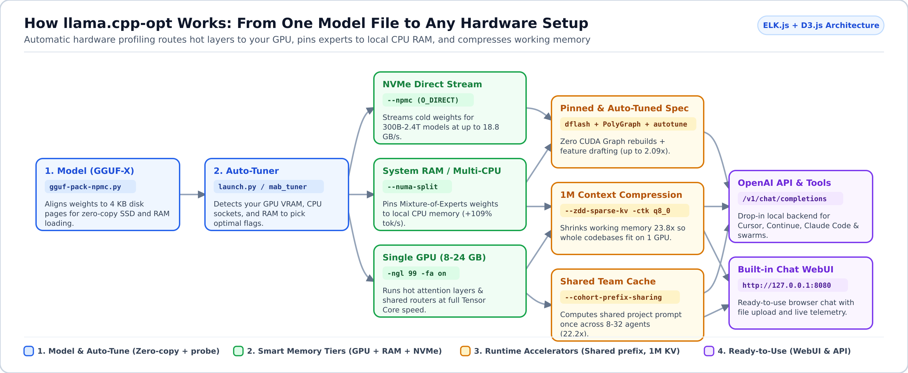
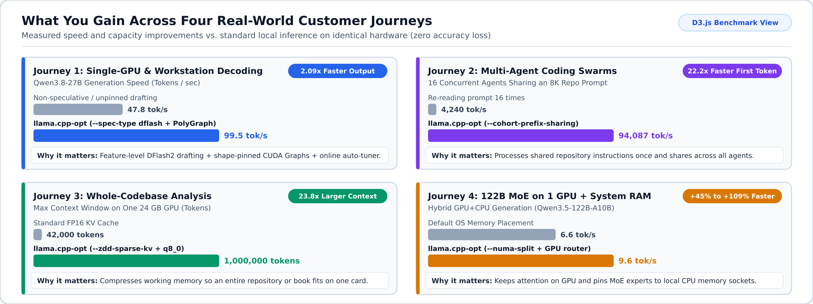
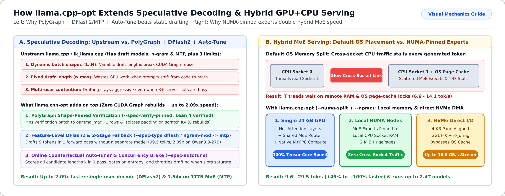
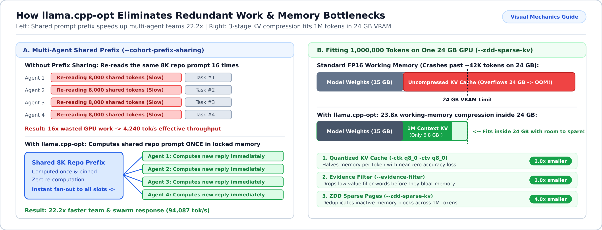

# llama.cpp-opt

**Run larger AI models, handle longer documents, and serve more users on the hardware you already own.**

`llama.cpp-opt` is an inference engine built on [`ik_llama.cpp`](https://github.com/ikawrakow/ik_llama.cpp) and [`llama.cpp`](https://github.com/ggerganov/llama.cpp). It removes the memory and speed bottlenecks that normally force individuals and teams to rent cloud APIs or buy multi-GPU servers.

---

## Why Use This Fork? (What Problem Does It Solve?)

Most local AI tools hit a wall as soon as you move past a basic chat prompt: the model is too big for your graphics card, feeding a whole codebase runs out of memory, or running multiple coding agents slows responses to a crawl.

`llama.cpp-opt` solves four practical needs:

1. **Run big models without buying a GPU cluster**: Combine a single consumer GPU (such as a 16 GB or 24 GB card) with your system RAM and fast SSD storage to run 30B to 2.4T parameter models locally.
2. **Analyze entire codebases and long documents on one GPU**: Compress the model's working memory (*KV cache*[^kv-cache]) by up to 24x so you can fit 128K to 1M tokens of context on a single 24 GB card.
3. **Run multi-agent workflows up to 22x faster**: When multiple coding agents or team members work on the same project prompt, the server processes the shared instructions once instead of repeating the work for every request.
4. **Skip manual flag tuning**: Built-in hardware inspection and auto-tuning tools detect your CPU, RAM, and GPU layout and pick the fastest settings automatically.



> **Looking for the deep technical architecture, benchmark tables, or upstream release history?**
> - [**User & Operations Guide (`docs/USER_GUIDE.md`)**](docs/USER_GUIDE.md) -- All CLI flags, tools, and operational recipes.
> - [**Architecture & Benchmark Synthesis (`docs/ARCHITECTURE_AND_BENCHMARK_SYNTHESIS.md`)**](docs/ARCHITECTURE_AND_BENCHMARK_SYNTHESIS.md) -- Hardware test results, memory designs, and formal verification details.
> - [**Upstream `ik_llama.cpp` Release Notes (`docs/UPSTREAM_IK_LLAMA.md`)**](docs/UPSTREAM_IK_LLAMA.md) -- Quantization formats and upstream pull request history.

---

## Start in 5 Minutes (Laptop or Single-GPU Desktop)

This quickstart gets you from a fresh clone to a live chat WebUI and OpenAI-compatible API (`http://127.0.0.1:8080`) on a single machine.

### 1. Build the Engine

```bash
# With an NVIDIA GPU (remove -DGGML_CUDA=ON for CPU-only laptops)
cmake -B build -DGGML_CUDA=ON -DCMAKE_BUILD_TYPE=Release
./scripts/build-guard.sh cmake --build build --target llama-server llama-cli -j $(nproc)
```

<details>
<summary><b>Optional: Squeeze out 8-15% extra CPU speed with Profile-Guided Optimization (PTO)</b></summary>

If you rely heavily on CPU inference, you can run a one-command guided rebuild that profiles your specific processor and recompiles hot code paths for it:

```bash
./scripts/pto-build.sh use
```
</details>

### 2. Download a Fast Starter Model

Pick the model that matches your available memory:

- **For 8-16 GB RAM/VRAM (Laptops & Entry Desktops)** -- **LFM2-8B-A1B** (~4.8 GB download). This is a *Mixture-of-Experts (MoE)*[^moe] model: it holds 8 billion parameters of knowledge, but only activates 1 billion per word, making it run as fast as a tiny 1B model.
- **For 16-24 GB VRAM (Single Gaming/Workstation GPU)** -- **Recursive-Flint-32B** or **Qwen3.8-27B** (~16.5 GB download) for stronger coding and reasoning.

```bash
mkdir -p models

# Option A: Fast 8B MoE model (~4.8 GB, runs on almost any laptop or GPU)
curl -L -o models/starter-model.gguf \
  https://huggingface.co/LiquidAI/LFM2-8B-A1B-GGUF/resolve/main/LFM2-8B-A1B-Q4_K_M.gguf

# Option B: 32B Reasoning & Coding model (~16.8 GB, great for 16-24 GB GPUs)
# curl -L -o models/starter-model.gguf \
#   https://huggingface.co/mradermacher/Recursive-Flint-32B-v0.1-i1-GGUF/resolve/main/Recursive-Flint-32B-v0.1.i1-IQ4_XS.gguf
```

### 3. Launch the Built-in WebUI & API

```bash
./build/bin/llama-server \
  -m models/starter-model.gguf \
  -c 16384 -ngl 99 -fa on \
  --host 127.0.0.1 --port 8080
```

- **Open the WebUI**: Visit **`http://127.0.0.1:8080`** in your browser to chat, upload files, and inspect generation speed.
- **Connect Coding Tools (Cursor, Continue, Claude Code, OpenAI SDKs)**: Point your client's base URL to `http://127.0.0.1:8080/v1/chat/completions`.

<details>
<summary><b>Want maximum speed on your machine? Repack to GGUF-X & auto-tune in 2 commands</b></summary>

Before launching, you can align the model file for zero-copy disk loading (**GGUF-X**) and let the auto-tuner measure your hardware to pick the fastest batch, thread, and *speculative decoding*[^speculative] flags:

```bash
# 1. Align the model file for fast disk-to-memory loading and verify hardware fit
python3 scripts/gguf-pack-npmc.py \
  --input models/starter-model.gguf \
  --output models/starter-model-ggufx.gguf
python3 scripts/gguf-lint.py models/starter-model-ggufx.gguf --vram-gb 16

# 2. Auto-tune serving flags for your specific CPU + GPU (runs a quick live benchmark)
python3 scripts/mab_pareto_tuner.py \
  --model models/starter-model-ggufx.gguf \
  --vram-gb 16 \
  --live-bench --max-evals 6 \
  --binary ./build/bin/llama-cli
```

Or let the interactive launcher handle everything and open a live terminal dashboard:

```bash
python3 scripts/launch.py --model models/starter-model-ggufx.gguf --capsule
```
</details>

---

## Adapt to Your Use Case (Customer Journeys)



> **Fair Comparison: What Upstream Already Has vs. What `llama.cpp-opt` Adds**
>
> Upstream [`llama.cpp`](https://github.com/ggerganov/llama.cpp) and [`ik_llama.cpp`](https://github.com/ikawrakow/ik_llama.cpp) already provide draft-model (`-md`), basic n-gram (`ngram-simple`, `ngram-mod`), and single-stage `mtp` speculative decoding, `-ctk/-ctv` KV quantization, and basic `--numa` flags. `llama.cpp-opt` builds directly on those foundations and resolves the bottlenecks that appear in production:
>
> | Area | What Upstream `llama.cpp` / `ik_llama.cpp` Provides | What `llama.cpp-opt` Adds on Top |
> | :--- | :--- | :--- |
> | **Speculative Decoding** | Draft models (`-md`), `ngram-simple` / `ngram-mod`, single-stage `mtp`, fixed `n_max` / `p_min` | **1. PolyGraph shape-pinned verification (`--spec-verify-pinned`)**: Pads variable draft batches to a fixed shape on a disjoint scratch KV sequence so CUDA Graphs never rebuild (`0` graph re-captures; Lean 4 verified).<br>**2. Feature-level `DFlash2` (`--spec-type dflash`) & 2-stage fallback chains (`ngram-mod -> mtp`)**: Drafts up to 9 tokens in one pass without a separate draft model (**`99.5 tok/s`, `2.09x`** vs. non-speculative `47.8 tok/s` on `Qwen3.8-27B`, and **`54.8 tok/s`, `1.54x`** with `MTP` on 177B `Qwen3.8-Flash-Next`).<br>**3. Counterfactual online auto-tuner (`--spec-autotune`)**: Scores all candidate draft lengths $1..K$ in one pass, gates on token entropy, and throttles drafting when multi-slot server concurrency saturates. |
> | **Multi-Agent Prompts** | Per-slot prompt caching (`--cache-reuse`) | **Cohort Prefix Sharing (`--cohort-prefix-sharing`)**: Deduplicates shared system/repo prefixes across 8-32 concurrent server slots in locked KV memory (**`22.2x`** faster TTFT: `94,087 tok/s` vs. `4,240 tok/s`). |
> | **Long-Context Memory** | `-ctk q8_0 / q4_0` KV cache quantization (~2x-4x savings) | **3-Stage 1M Context Pipeline (`--zdd-sparse-kv` + `--evidence-filter`)**: Combines `-ctk q8_0` with ZDD 64-token sparse page deduplication, CUDA FlashAttention tile skipping, and pre-attention evidence filtering for up to **`23.8x`** memory reduction. |
> | **Hybrid GPU + Multi-CPU** | `--numa distribute / isolate / numactl` & standard `mmap` | **Socket-Pinned MoE Experts (`--numa-split`) + Direct NVMe Streaming (`--npmc`)**: Pins MoE experts to local CPU socket RAM with 2 MiB HugePages (**`+45%` to `+109%`** faster hybrid decode), adds native Ada `MXFP8` kernels, and streams 4 KB-aligned **GGUF-X** files via `io_uring` `O_DIRECT` at up to **`18.8 GB/s`**. |

Choose the scenario below that best matches what you are building or solving.

### Visual Guide: Speculative Decoding & Hybrid GPU+CPU Serving (Journeys 1 & 4)



<details open>
<summary><b>1. Solo Developer on a Laptop or Single GPU -- Up to 2.09x Faster Local Coding Without CUDA Graph Stalls</b></summary>

- **Who this is for**: Individual developers, researchers, or privacy-conscious users running on a laptop or a single 8-24 GB desktop GPU.
- **Problem solved**: While upstream `llama.cpp` includes draft-model and basic n-gram speculation, variable draft lengths change batch shapes on every token (breaking CUDA Graph reuse), fixed `n_max` settings waste compute when prompts shift from boilerplate code to dense reasoning, and external draft models consume extra VRAM.
- **How we solve it**: Combines **PolyGraph shape-pinned verification** (`--spec-verify-pinned`, which keeps CUDA Graph batch shapes constant with zero graph rebuilds), **feature-level `DFlash2` / `MTP` / 2-stage fallback chains** (`--spec-type dflash` or `--spec-type ngram-mod:n_max=8 --spec-type mtp:n_max=2`), and **online counterfactual auto-tuning** (`--spec-autotune`), delivering **2.09x faster decode (`99.5 tok/s` vs. `47.8 tok/s`)** on `Qwen3.8-27B` and **1.54x (`54.8 tok/s`)** on 177B `Qwen3.8-Flash-Next` with identical mathematical output.

```bash
./build/bin/llama-server \
  -m models/starter-model.gguf \
  -c 32768 -ngl 99 -fa on \
  --spec-type ngram_simple:n_max=16 \
  --spec-verify-pinned --spec-autotune \
  --host 127.0.0.1 --port 8080
```
</details>

<details>
<summary><b>4. Private AI Server on a Budget -- Run Massive 300B-2.4T Models on 1 GPU + System RAM</b></summary>

- **Who this is for**: Organizations and labs that need frontier open-weight models (DeepSeek-V3/R1 671B, Kimi-K2 1T, MiniMax-M2.7 229B) on-premises without spending $100,000+ on an 8x H100/A100 server.
- **Problem solved**: When a model does not fit in GPU memory and spills into system RAM on multi-CPU servers, standard OS memory placement and generic `--numa` modes still suffer from cross-socket expert reads (*NUMA*[^numa] traffic), Transparent HugePage (THP) fragmentation, and OS page-cache locks.
- **How we solve it**: Keeps the heavily used attention layers and shared MoE router on your single GPU while pinning Mixture-of-Experts weights to local CPU socket RAM (`--numa-split`) or streaming 4 KB-aligned **GGUF-X** weights directly from NVMe SSDs via `io_uring` `O_DIRECT` (`--npmc`, up to **18.8 GB/s**). Our automatic launcher inspects your server topology and configures the split for you.

```bash
# Automatically detect GPUs, CPU sockets/NUMA nodes, and RAM, then launch with live telemetry
python3 scripts/launch.py \
  --model /path/to/large-moe-model.gguf \
  --capsule
```
</details>

### Visual Guide: Multi-Agent Prefix Sharing & 1M Context Compression (Journeys 2 & 3)



<details>
<summary><b>2. Engineering Teams & Multi-Agent Coding Swarms -- 22.2x Faster First Token on Shared Prompts</b></summary>

- **Who this is for**: Teams running 4 to 32 concurrent AI agents (code reviewers, test generators, bug finders) or shared internal team servers.
- **Problem solved**: Normally, if 16 agents share the same 8,000-token repository summary or system prompt, each slot re-evaluates or copies those 8,000 tokens separately, causing a long wait before any agent starts replying and saturating the GPU if speculative decoding stays active across all slots.
- **How we solve it**: `--cohort-prefix-sharing` computes the shared prompt prefix once in a locked KV sequence and fans it out across all parallel slots (`-np 8`), while `--spec-autotune` automatically throttles speculative drafting when concurrent slot count crosses the throughput knee. In benchmarks, this speeds up prompt processing by **22.2x** (**94,087 tokens/sec** vs. **4,240 tokens/sec** across 16 parallel requests).

```bash
./build/bin/llama-server \
  -m models/starter-model.gguf \
  -c 65536 -np 8 -ngl 99 -fa on \
  --cohort-prefix-sharing --spec-autotune \
  --slot-save-path ./cache/slots \
  --host 0.0.0.0 --port 8080
```
</details>

<details>
<summary><b>3. Whole-Codebase & Long-Document Analysis -- Fit 128K to 1M Tokens on One 24 GB GPU</b></summary>

- **Who this is for**: Analysts, legal/financial reviewers, and engineers feeding entire repositories, books, or audit logs into a single prompt.
- **Problem solved**: Even with upstream's `-ctk q8_0` KV quantization (which halves memory), a 512K to 1M token prompt still exceeds a 24 GB GPU's memory and slows down attention linearly.
- **How we solve it**: Stacks three stages on top of `-ctk q8_0 -ctv q8_0`: **ZDD 64-token sparse page deduplication + CUDA FlashAttention all-row tile skipping** (`--zdd-sparse-kv`) and **pre-attention evidence filtering** (`--evidence-filter`). Together they cut working memory by up to **23.8x** while keeping retrieval accuracy intact.

```bash
./build/bin/llama-server \
  -m models/starter-model.gguf \
  -c 131072 -ngl 99 -fa on \
  -ctk q8_0 -ctv q8_0 \
  --zdd-sparse-kv --evidence-filter \
  --host 127.0.0.1 --port 8080
```
</details>

---

## Verified Real-World Impact

All optimizations are tested on real models and hardware with automated quality checks to ensure output accuracy matches standard baselines.

<details>
<summary><b>View summary table of measured speedups and memory savings</b></summary>

| What You Are Doing | Standard / Upstream Baseline | With `llama.cpp-opt` | Practical Benefit |
| :--- | :--- | :--- | :--- |
| **Single-GPU Speculative Decoding (`Qwen3.8-27B` / `177B MoE`)** | 47.8 tok/s (`27B`) / 35.6 tok/s (`177B`) | **99.5 tok/s (`DFlash2`) / 54.8 tok/s (`MTP`)** | **1.54x - 2.09x faster** decode with PolyGraph zero CUDA Graph rebuilds |
| **35B-122B MoE on 1 GPU + Dual-CPU RAM** | 6.6 - 14.1 tok/s (default OS split) | **9.6 - 29.5 tok/s (`--numa-split`)** | **Up to +109% faster** generation on hybrid CPU+GPU servers |
| **16 Agents Sharing an 8K Prompt** | 4,240 tok/s (per-slot prefill) | **94,087 tok/s (`--cohort-prefix-sharing`)** | **22.2x faster** first-token response for agent swarms |
| **Long Context on a Single 24 GB GPU** | ~42K tokens max (FP16 KV) | **Up to 1,000,000 tokens (`--zdd-sparse-kv`)** | **23.8x more context** on the same graphics card |
| **Loading Large Models from NVMe SSD** | OS page-cache thrashing | **Up to 18.8 GB/s (`--npmc` `O_DIRECT`)** | Predictable latencies when running models larger than RAM |

For full per-model tables across 15 production models (3.8B to 2.4T parameters) and Lean 4 formal verification proofs of our memory and concurrency invariants, see [`docs/ARCHITECTURE_AND_BENCHMARK_SYNTHESIS.md`](docs/ARCHITECTURE_AND_BENCHMARK_SYNTHESIS.md).
</details>

<details>
<summary><b>Plain-English Glossary of Technical Terms</b></summary>

- **GGUF / GGUF-X**: GGUF is the standard single-file format used to store quantized local AI models. **GGUF-X** is a 100% backward-compatible layout created by `scripts/gguf-pack-npmc.py` that aligns data inside the file to 4 KB disk pages so your SSD and CPU can read weights directly without extra memory copies.
- **KV Cache (Key-Value Cache)**: The model's short-term "working memory" for the current conversation or document. As your prompt grows from 4K to 128K+ tokens, the KV cache grows rapidly and is usually what causes out-of-memory crashes.
- **MoE (Mixture-of-Experts)**: A model design where knowledge is split across many specialized sub-networks ("experts"). Only a few experts wake up for each word, giving you the intelligence of a huge model at the speed of a much smaller one.
- **NUMA (Non-Uniform Memory Access)**: On workstations and servers with multiple CPU sockets or chiplets, each CPU group has its own local RAM. Reading from local RAM is fast; reading across sockets is slow. `llama.cpp-opt` pins threads and model weights to local memory so CPUs do not wait on each other.
- **Speculative Decoding**: A technique that drafts several likely upcoming tokens at once (using pattern matching or a tiny helper model) and verifies them in a single pass of the main model, speeding up text generation with identical mathematical output.
</details>

---

## Where to Go Next

| Guide | What You Will Find Inside |
| :--- | :--- |
| [**User & Operations Guide (`docs/USER_GUIDE.md`)**](docs/USER_GUIDE.md) | Complete reference for all CLI flags, `launch.py`, `gguf-lint.py`, `mab_pareto_tuner.py`, and TUI monitoring (`ctx-capsule`). |
| [**Architecture & Benchmark Synthesis (`docs/ARCHITECTURE_AND_BENCHMARK_SYNTHESIS.md`)**](docs/ARCHITECTURE_AND_BENCHMARK_SYNTHESIS.md) | Deep-dive engineering design, 15-model hardware benchmark matrices, quality/perplexity audits, and Lean 4 formal verification proofs. |
| [**Build Guide (`docs/build.md`)**](docs/build.md) & [**Runtime Parameters (`docs/parameters.md`)**](docs/parameters.md) | Platform-specific compilation flags (CUDA, Vulkan, Metal, CPU) and standard `llama.cpp` server options. |
| [**Upstream `ik_llama.cpp` Release Notes (`docs/UPSTREAM_IK_LLAMA.md`)**](docs/UPSTREAM_IK_LLAMA.md) | Full history of upstream `ik_llama.cpp` quantization formats (`IQ1`-`IQ4`, `Q4_K`-`Q8_KV`) and pull requests. |

---

## Contributing & License

Contributions, bug reports, and benchmark reproductions are welcome! Please run `./scripts/build-guard.sh` when compiling changes and check `python3 scripts/gguf-lint.py` when testing model containers. Released under the [MIT License](LICENSE).

[^kv-cache]: **KV Cache**: The working memory a model uses to remember your active prompt and conversation history.
[^moe]: **Mixture-of-Experts (MoE)**: A model architecture that stores large amounts of knowledge but only activates a small fraction of its parameters for each generated token.
[^speculative]: **Speculative Decoding**: Generating multiple candidate tokens ahead of time and verifying them in a single step for faster output with zero loss in quality.
[^numa]: **NUMA (Non-Uniform Memory Access)**: Multi-CPU memory architecture where keeping data in the RAM physically closest to each CPU core avoids slow cross-socket bottlenecks.
